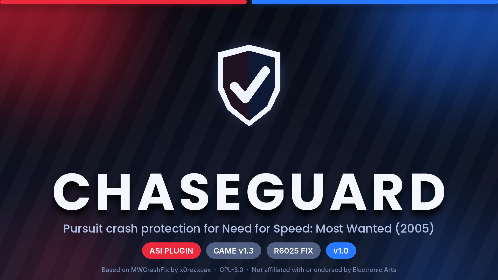

# ChaseGuard

Pursuit crash protection for **Need for Speed: Most Wanted (2005), v1.3** – an ASI plugin that prevents the
`Debug Error: R6025 - pure virtual function call` crash in long pursuits and adds a guarded crash-recovery layer.

ChaseGuard is a **fork of [MWCrashFix](https://github.com/x0reaxeax/MWCrashFix) by x0reaxeax**, based on its build
that includes the exception handler (PE timestamp 2025-02-15). Same patch table, safer behaviour.

## What it does

1. Patches 434 instructions in `speed.exe` so the faulty pursuit event pointer (`0x890970`) is replaced by another one
   (`0x8aa828`). Every location is verified against the expected bytes before it is written.
2. Installs an exception handler that can recover from certain access violations raised by the game's own code.
   It ignores everything that does not come from the game.

## What is different from the base build

- A failed instruction check / `VirtualProtect` now **exits cleanly** instead of falling through, logging "Patched…" and installing the handler anyway.
- The handler only reacts to faults whose address (or return address) is **inside the game image** (`0x00401000–0x00FFFFFF`); everything else is passed on untouched.
- Executable-page test accepts **all executable protections**, not only `PAGE_EXECUTE_READ`.
- No more second fault inside the disassembler when the game jumps to non-executable memory.
- The crash register dump goes to **`chaseguard.log`** (it went to `stderr` before).
- If the log file cannot be created, the patches are **still applied** (log falls back to `NUL`).
- Renamed MWCrashFix → ChaseGuard (file, DLL name, log, message-box titles).

Full list: [CHANGELOG.md](CHANGELOG.md).

## Install

Requirements: NFS Most Wanted (2005) `speed.exe` v1.3, an ASI loader (the game must load `*.asi` from `scripts`),
Microsoft Visual C++ Redistributable 2015–2022 **x86**.

1. Delete any old `MWCrashFix.asi` from `<game folder>\scripts` – do **not** keep both.
2. Copy `ChaseGuard.asi` (from the [Releases](../../releases) page) into `<game folder>\scripts`.
3. Start the game. Uninstall = delete the file.

`chaseguard.log` appears next to the game and grows with every launch (safe to delete). Lines starting with
`Faulting address` mean the handler caught a crash in game code – please attach the log to bug reports.

Works together with GrimMaple's [mwfixes](https://github.com/GrimMaple/mwfixes) (as documented for MWCrashFix);
its "Roadblock spawn problem fix" becomes redundant.

## Known limitations

- No rollback if a mismatch is found in the middle of the patch table (on a wrong `speed.exe` the first check fails, so nothing is written).
- The handler's "return from a bad call" emulation is exact only for calls where the caller cleans the stack.
- Tested for several hours together with other mods without crashes – not a guarantee; feedback is welcome.

## How it was built

ChaseGuard 1.0 is a **binary-patched derivative** of the base build, not a recompile. The scripts in [`source/`](source)
reproduce it byte for byte (see [`source/BUILD.txt`](source/BUILD.txt)):

| File | SHA-256 |
|------|---------|
| base build (`orig.asi`) | `df66b419871fbc705d2de093613b4dffc72db5446c5778994c28d7186ff701a6` |
| `ChaseGuard.asi` 1.0 | `d462c1b6e40d63f45212aad5275cbbe0179e1fa9c913aaa259cab12a767a4a77` |

## Credits

- **MWCrashFix** – original idea, patch table and exception handler: [x0reaxeax](https://github.com/x0reaxeax/MWCrashFix) ([NFSMods page](https://nfsmods.xyz/mod/5970))
- Related: [mwfixes](https://github.com/GrimMaple/mwfixes) by GrimMaple
- The DLL statically contains the [Zydis](https://github.com/zyantific/zydis) disassembler library (Zyantific; MIT License)

## License

[GPL-3.0](LICENSE), like the original project. This is a modified version of MWCrashFix (first modified release: 2026-11-19).
Not affiliated with or endorsed by Electronic Arts. "Need for Speed" is a trademark of Electronic Arts Inc.
